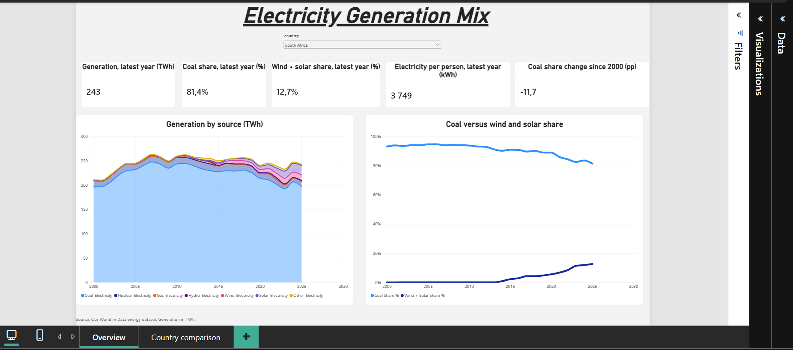
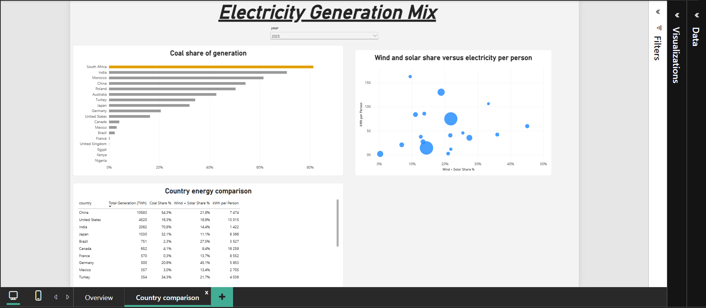

# Electricity generation mix: Power BI dashboard

An interactive Power BI dashboard comparing electricity generation by source, coal dependence, wind and solar growth, and electricity generated per person for 20 countries from 2000 to 2025, with a focus on South Africa.

**Tools:** Power BI Desktop, DAX, Power Query

## Questions the dashboard answers
- How is a country's electricity generation split between coal, gas, nuclear, hydro, wind, solar and other sources, and how has that changed since 2000?
- How does South Africa's coal dependence and wind and solar share compare with other countries in a given year?
- How much electricity does each country generate per person?

## Dashboard pages
**1. Overview.** Pick a country to see its latest-year generation, coal share, wind and solar share, generation per person, and the change in coal share since 2000, plus generation by source over time and coal versus wind and solar share.

**2. Country comparison.** Pick a year to compare coal share, wind and solar share, and generation per person across countries, with South Africa highlighted.




## What it shows (2025, 18 countries with data)
- South Africa has the highest coal share of generation (81.4%), ahead of India (70.8%) and Morocco (61.5%). It was 93.1% in 2000.
- South Africa's wind and solar share (12.7%) ranks 14th of 18. Germany is highest (45.1%).
- South Africa generates about 3,749 kWh per person, 11th of 18. Canada is highest (about 16,259 kWh).

Indonesia and Saudi Arabia have no 2025 data in the source, so they appear for earlier years only.

## Files
```
electricity_dashboard.pbix   the Power BI report (open with Power BI Desktop, which is free for Windows)
data/electricity_data.csv    cleaned data used by the report
DAX_measures.md              every measure used, with formulas
```

## Data preparation
- Source: Our World in Data energy dataset (github.com/owid/energy-data), which compiles data from Ember, the Energy Institute and other sources.
- Kept 20 countries and the years 2000 to 2025.
- Combined oil, biofuel and other renewables (including geothermal) into one "other" source.
- Treated missing values for a source as zero when the country has a reported total, for example nuclear in countries with no nuclear power.
- Checked that the seven sources add up to each country's reported total (largest gap: 0.0%).

## Limitations
Generation is not demand or capacity. Annual totals hide outages. Population figures are estimates, and the latest years may be revised in later releases of the source data.

## Data credit
Our World in Data energy dataset: https://github.com/owid/energy-data. Credit Our World in Data if you reuse the data, and check the source repository for its current licence terms.

## How this was built
Developed with AI assistance (data preparation and measure design). The author built the report in Power BI Desktop, checked the numbers and is responsible for the analysis.
